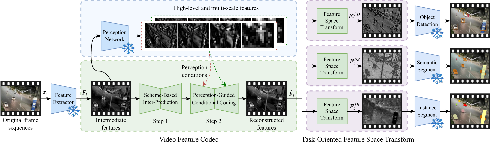

# TransVFC

**A Transformable Video Feature Compression Framework for Machines**

> 📄 **Paper:** [Pattern Recognition, 2025](https://www.sciencedirect.com/science/article/abs/pii/S0031320325007514)
>
> 📅 Submitted 2025.01 &nbsp;|&nbsp; Accepted 2025.07

---

## Overview

TransVFC is a learnable feature-domain video codec designed for **video understanding pipelines** (e.g. object detection, segmentation, tracking). Instead of compressing pixel-level video, TransVFC compresses intermediate features produced by a frozen vision backbone — saving bitrate while preserving task accuracy.

<p align="center"></p>

Key components:

- **Motion-guided temporal prediction** in the feature space
- **Multi-scale contextual coding** with FPN-like high-level conditioning from the task head
- **Hyperprior entropy model** with scale-adaptive Laplace distributions

> ⚠️ **Work in progress** — we are releasing code incrementally after publication. This repository currently contains the core `FeatureCodec` model definition.

---

## Structure

```
.
├── feature_codec.py    # Self-contained FeatureCodec class + all sub-modules
├── README.md
└── assets/
```

`feature_codec.py` is a single-file, dependency-light module. Everything needed to define and run the `FeatureCodec` model is in one file — no C++ extensions, no custom ops beyond PyTorch.

---

## Quick Start

```python
import torch
from feature_codec import FeatureCodec

# 1. Your pre-trained detection / segmentation head (frozen)
class MyTaskHead(torch.nn.Module):
    def forward(self, mid_feature):
        # mid_feature: B×256×H×W  (e.g. FPN P3)
        # Must return dict: {'p2','p3','p4','p5','p6'} at FPN scales
        return {
            'p2': p2_feat,   # B×256×H×W
            'p3': p3_feat,   # B×256×H/2×W/2
            'p4': p4_feat,   # B×256×H/4×W/4
            'p5': p5_feat,   # B×256×H/8×W/8
            'p6': p6_feat,   # B×256×H/16×W/16
        }

model = FeatureCodec(task_head=MyTaskHead())

# 2. Compress features
recon, warped, mse_dict, bpp_dict = model(
    input_feature_mid,   # current frame
    refer_feature_mid,   # reference frame
)
```

### Input / Output

| Name | Shape | Description |
|------|-------|-------------|
| `raw_input_feature_mid` | `B×256×H×W` | Mid-level feature of the current frame |
| `raw_refer_feature_mid` | `B×256×H×W` | Mid-level feature of the reference frame |
| `raw_recon_feature_mid` | `B×256×H×W` | Reconstructed mid-feature |
| `raw_warped_feature_mid` | `B×256×H×W` | Motion-compensated mid-feature |
| `mse_dict` | `dict` | Distortion at each pyramid level |
| `bpp_dict` | `dict` | Bit-rate breakdown (y, z, mv) |

---

## Citation

```bibtex
@article{transvfc2025,
  title   = {{TransVFC}: A Transformable Video Feature Compression Framework
             for Machines},
  journal = {Pattern Recognition},
  year    = {2026},
  month   = {March},
  doi     = {10.1016/j.patcog.2025.112091},
  url     = {https://www.sciencedirect.com/science/article/abs/pii/S0031320325007514},
}
```

---

## License

This project is released under the [Apache License 2.0](LICENSE).
